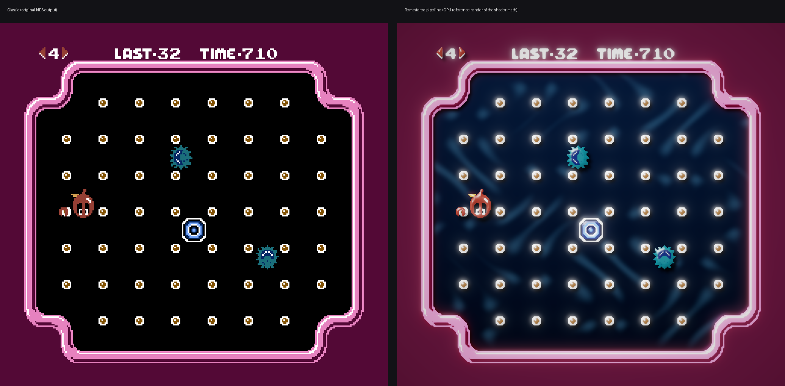

# Clu Clu Land Remastered (macOS · Metal)



A native macOS app that runs **your own Clu Clu Land ROM** (not included) unchanged and renders it with a
modern Metal pipeline. The game logic is the original 1984 code; only the presentation is new.

## Build & run

Requirements: macOS 13 Ventura or newer, Xcode 15+ (or the Command Line Tools with Swift 5.9+).

```bash
./build_app.sh                 # → build/Clu Clu Land Remastered.app
open "build/Clu Clu Land Remastered.app"
```

* `UNIVERSAL=1 ./build_app.sh` builds an Apple-silicon + Intel binary.
* `swift run` also works for quick iteration.
* If `../Clu Clu Land.nes` exists, the script copies it into the app bundle. Otherwise the app
  remembers the last ROM you opened. You can also drag a `.nes` file onto the window or use **File › Open ROM… (⌘O)**.

## How it works

| Layer | What it does |
|---|---|
| `Sources/NESCore` (C) | Cycle-counted 6502 CPU, 2C02 PPU (scanline renderer with proper scrolling and sprite-0 hit), 2A03 APU (2 pulse, triangle, noise, DPCM, console-style filtering), NROM cartridge, controllers, save states. Besides the normal picture, the PPU exports **per-pixel colour layers** (background, sprites with priority, backdrop per scanline). |
| `Renderer.swift` + `Shaders.swift` | Metal pipeline: height-map compute → resolution-independent reconstruction of the pixel art → lit scene → bloom chain → filmic composite. |
| `GameSession.swift` | Frame pacing (locked to 60 Hz displays, accumulator otherwise), dynamic audio-rate control, save states, hotkeys. |
| `Input.swift` | Keyboard and GameController input, live rebinding, turbo buttons. |
| `SettingsView.swift` | Settings window (⌘,): Graphics, Controls, Audio. Everything persists automatically. |

### The "2026" renderer
Because it works from the PPU's colour layers rather than a finished bitmap, the remastered
mode can treat background and sprites as separate surfaces:

* **Reconstruction**: each output texel builds a Gaussian coverage field from the surrounding
  NES pixels and thresholds it with anti-aliasing. Staircases turn into clean diagonals and
  curves, flat colour regions stay crisp, and it works at any resolution (up to 8× internal).
* **Surface lighting**: a B-spline-smoothed height field gives every shape a bevelled,
  glossy look (diffuse + specular + rim light), with an adjustable light direction.
* **Soft shadows**: sprites cast shadows on the playfield; walls cast shadows on the backdrop.
* **Animated deep-sea backdrop**: caustics, light shafts and rising bubbles replace the flat
  backdrop colour, tinted by whatever colour the game sets.
* **HDR post**: bloom (soft-knee threshold, 6-level dual filter), ACES tonemapping, exposure,
  saturation and contrast, vignette, chromatic aberration, film grain.
* **Ambient border**: pillarbox bars glow with a blurred version of the picture.
* Also included: **Classic** (sharp anti-aliased pixels, optional integer scaling) and **CRT**
  (beam-width scanlines, aperture grille, curvature) modes, 4:3 NTSC or square pixels,
  overscan crop, NES palette hue and saturation, and a "no sprite flicker" option.

### Remastered 2026 sound & music
Settings › Audio › **Sound & music** switches between:

* **Original (NES 2A03)**: the authentic, cycle-accurate sound chip.
* **Remastered 2026**: the same music and effects, performed live by a modern synth that reads the
  sound chip's registers every sample. You get band-limited lead instruments (Clean, Warm Analog or
  Supersaw), a warm bass with a sub-octave, filtered drums, smoothed envelopes without zipper noise,
  stereo placement with chorus, a hall reverb and a soft limiter. You can adjust reverb, stereo width and bass,
  and each channel can still be muted on its own. Both modes are level-matched.

Presets are in **Game › Graphics Preset**: Remastered Ultra, Remastered Light, Classic, CRT.

## Default controls

| NES | Player 1 | Player 2 | Gamepad |
|---|---|---|---|
| D-Pad | Arrow keys | I J K L | D-Pad / left stick |
| A | X | H | East (B / ○) |
| B | Z | G | South (A / ✕) |
| Turbo A / B | S / A | – | North / West |
| Start | Return | Y | Menu |
| Select | Right Shift | T | Options |

Shortcuts: **P** pause, **Tab** (hold) fast-forward, **F5** quick save, **F7** quick load,
**F2** reset. These also have menu equivalents: ⌘P, ⌘S, ⌘L, ⌘R. All of them can be rebound in Settings › Controls.

## Notes
* Only mapper-0 (NROM) ROMs are supported. That covers Clu Clu Land and other early titles.
* Save states live in `~/Library/Application Support/Clu Clu Land Remastered/States/`.
* `Tools/headless.c` is a command-line test runner for the core:
  `cc -O2 -ISources/NESCore/include Sources/NESCore/nescore.c Tools/headless.c -o headless -lm`
